# Evaluar Cortex — la demostración en vivo, paso a paso

[English](evaluation-runbook.md) · **Español** · [Português](evaluation-runbook.pt.md) · Guía rápida: [EN](cortex-basic-guide.pdf) · [ES](guia-basica-cortex.pdf) · [PT](guia-basico-cortex.pdf)

Para quien evalúa, para la arquitecta o el arquitecto y para la dirección, tengan cinco minutos
o una tarde. Cada paso de esta guía se realizó en
[cortex.gonzaloromeroai.com](https://cortex.gonzaloromeroai.com), y cada captura se tomó de la
plataforma con un script que ingresa como usted lo hará: los recuadros rojos, los números y las
notas son lo único agregado. No hace falta instalar nada, y nada de lo que haga puede romper la
demostración: se restaura al mismo estado todas las noches.

La interfaz está en inglés; los nombres de pantallas y botones se dan aquí tal como aparecen,
con su sentido en español.

`python examples/evaluate/journey.py` recorre cada recorrido de esta guía por la misma API que
usan las pantallas e imprime PASS o FAIL para cada afirmación. Ejecútelo primero si prefiere
comprobar a leer.

---

## Antes de empezar

Dos cuentas públicas, ambas en la organización **`carrier-large`**: un operador de
telecomunicaciones de unos 900.000 clientes, el mayor de los tres de esta instalación. Las
contraseñas y el secreto del autenticador del evaluador están en el
[README](../README.md#evaluating-the-live-demonstration).

| Cuenta | Qué es | Para qué usarla |
| --- | --- | --- |
| `evaluator` | Un administrador al que se le retienen seis cosas: administrar personas y roles, restablecer credenciales ajenas, suplantar identidad y el re-sellado de claves | Ver todas las pantallas y hacer casi todo lo que hace un administrador |
| `agent` | Un empleado: un agente de centro de atención | Ver las reglas de acceso desde el lado que protegen |

Algunas acciones piden un segundo factor. Cuando eso ocurra, el código lo da
`python examples/evaluate/totp.py` —el secreto publicado, RFC 6238, con los segundos que le
quedan— o cualquier app autenticadora cargada con el secreto.

### El recorrido de cinco minutos

1. Ingresar como `evaluator` ([Recorrido 1](#recorrido-1--ingreso-y-elevación-de-la-sesión)).
2. **Customers**, escribir `Subject 000` ([Recorrido 2](#recorrido-2--personas-y-visión-del-cliente)).
3. **Assistant**, preguntar *¿Cuánto tarda la portabilidad numérica?* ([Recorrido 3](#recorrido-3--conocimiento-y-asistente-fundamentado)).
4. Dar al agente acceso a una colección y ver cómo cambian sus respuestas ([Recorrido 4](#recorrido-4--control-de-acceso-visto-desde-el-lado-que-protege)).
5. **Audit trail**: el permiso recién otorgado aparece arriba ([Recorrido 5](#recorrido-5--claves-de-cifrado-y-auditoría)).

---

## Recorrido 1 — Ingreso y elevación de la sesión

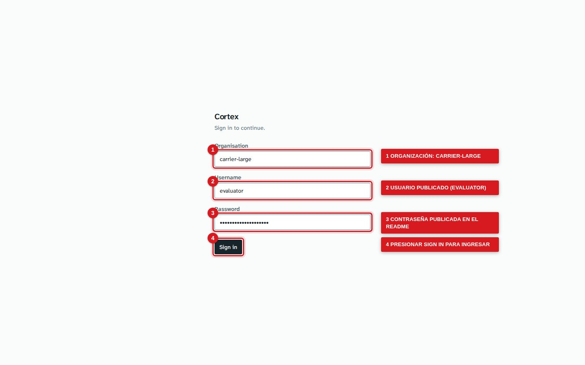

1. **Organisation** (organización) `carrier-large`, **Username** (usuario) `evaluator`,
   **Password** (contraseña) la del README.
2. **Sign in** (ingresar).

La sesión que recibe queda atada a una clave que su navegador generó y nunca envió (DPoP,
RFC 9449): el token de acceso solo no le sirve a nadie que lo copie. El ingreso de esta cuenta
está *administrado por la instalación*: no se le pedirá cambiar la contraseña, y nadie puede
bloquearla, cambiarla ni cerrar las sesiones de los demás desde adentro.

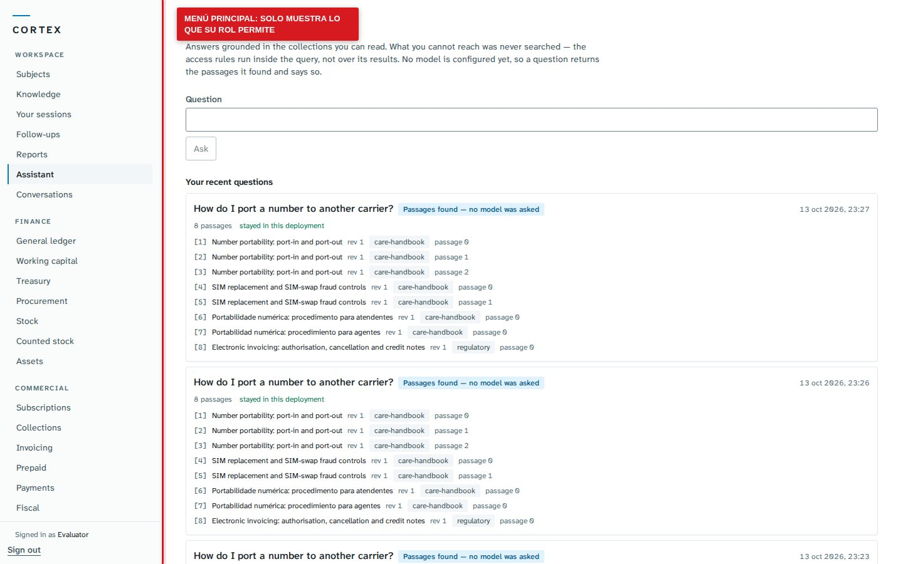

El menú se agrupa por área —Workspace, Customers, Commercial, Finance, Operations, People,
Administration— y muestra solo lo que esta cuenta puede usar. Una pantalla que no puede usar no
aparece en gris: no aparece, y tampoco el pedido que hubiera sido rechazado.

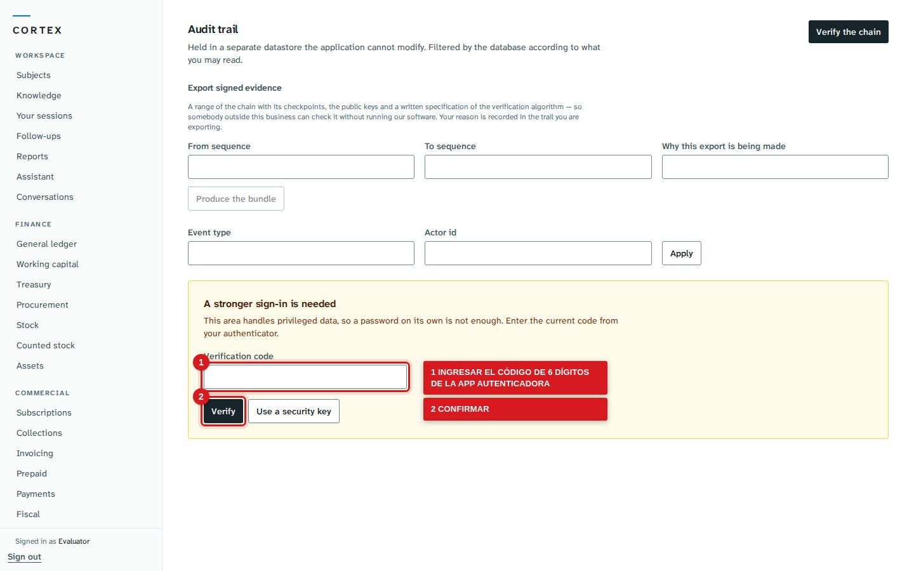

**Audit trail** (auditoría) exige nivel de seguridad 2. La pantalla pide un **Verification
code** (código de verificación): ejecute `python examples/evaluate/totp.py`, escriba los seis
dígitos y confirme. La sesión se eleva en el lugar, solo esta sesión; nada de lo que tenía
abierto se ve afectado. (Re-sellar todos los valores cifrados exige nivel 3 —una llave de
seguridad—, una de las razones por las que el evaluador público no lo tiene.)

---

## Recorrido 2 — Personas y visión del cliente

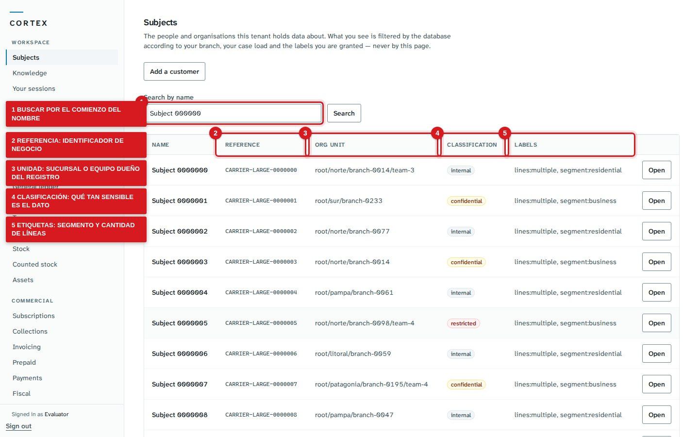

**Workspace → Subjects** son todas las personas y organizaciones que el inquilino registra
—clientes, prospectos, registros de empleados—, no solo quienes compran algo. Se busca por el
comienzo del nombre: `Subject 000000`.

| Columna | Qué es | Por qué está |
| --- | --- | --- |
| **Reference** | El identificador de negocio, `CARRIER-LARGE-0000000` | Lo que citan otros sistemas y las personas; el identificador interno es un ULID que nadie lee |
| **Org unit** | Dónde vive el registro: `root/norte/branch-0014/team-3` | El inquilino tiene cinco regiones, ~250 sucursales y sus equipos. Gerentes y agentes ven los registros de su unidad y las inferiores; la columna es lo que esa regla lee |
| **Classification** | `internal`, `confidential` o `restricted` | Quién puede ver los datos personales del registro, y si algo de él puede llegar alguna vez a un modelo externo |
| **Labels** | `segment:residential`, `segment:business`, `lines:multiple` | Segmentos de los clientes con líneas. Una etiqueta también puede ser la restricción de un rol: un rol puede leer solo los registros etiquetados para él |

Los 900.000 están segmentados como la cartera de un operador real porque el control de acceso
por fila solo se demuestra con un inquilino que tiene filas en muchos lugares: un gerente de
sucursal en `root/sur` ve `root/sur` y nada de `root/norte`, y cada lista de cada pantalla se
filtra dentro del SQL y no después.

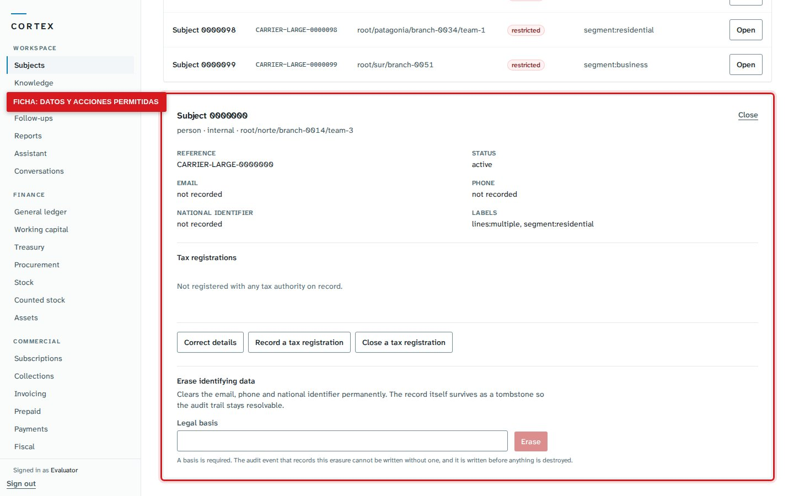

**Open** (abrir) en una fila: sus datos y las acciones que esta cuenta puede hacer sobre ella,
decididas por el servidor para esa fila. Los datos personales que un rol no puede leer los
enmascara el servidor, no la pantalla: el valor sin enmascarar nunca llega a un navegador que no
puede mostrarlo.

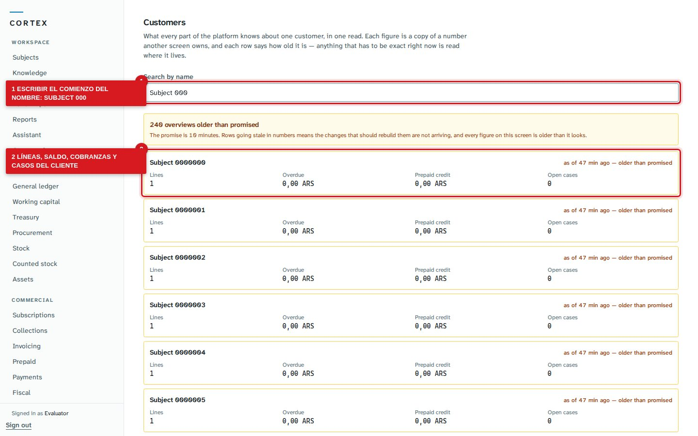

**Customers → Customers** es la vista desde la que un agente atiende una llamada: las líneas
activas y bloqueadas de cada cliente, el saldo adeudado, el crédito, el estado de cobranza y los
casos abiertos, en una sola fila y en una sola lectura indexada. Escriba **el comienzo de un
nombre** —`Subject 000`, `Subject 0000123`—: la búsqueda es por prefijo, sin distinguir
mayúsculas, que es la consulta que usa el índice en un inquilino de 900.000 filas; no se ofrece
buscar un fragmento en el medio del nombre, porque no puede ser rápido. La vista contiene a los
clientes que tienen líneas —240 en `carrier-large`— y cada uno muestra qué tan reciente es su
fila.

---

## Recorrido 3 — Conocimiento y asistente fundamentado

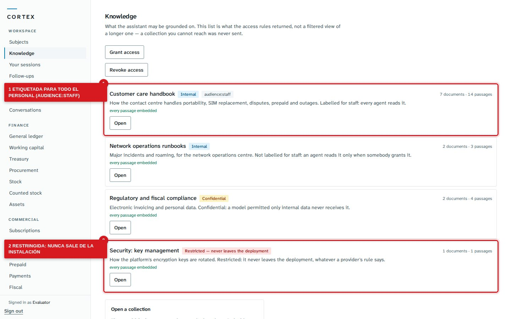

**Workspace → Knowledge** lista las colecciones en las que el asistente puede fundamentarse,
tal como las devolvieron las reglas de acceso: no es una vista filtrada de una lista más larga.
La demostración trae cuatro, de documentos operativos reales, en cuatro niveles de sensibilidad:

| Colección | Sensibilidad | Contiene | La alcanzan |
| --- | --- | --- | --- |
| `care-handbook` | internal, etiquetada `audience:staff` | Portabilidad (en inglés, español y portugués), reemplazo de SIM y fraude por SIM swap, reclamos de facturación, prepago, créditos por cortes | Todo empleado |
| `network-operations` | internal | Incidentes mayores, roaming | Administradores, o un permiso |
| `regulatory` | confidential | Facturación electrónica, datos personales | Administradores, o un permiso; nunca un modelo autorizado solo para datos internos |
| `security` | restricted | Gestión y rotación de claves | Administradores, o un permiso; nunca sale de la instalación |

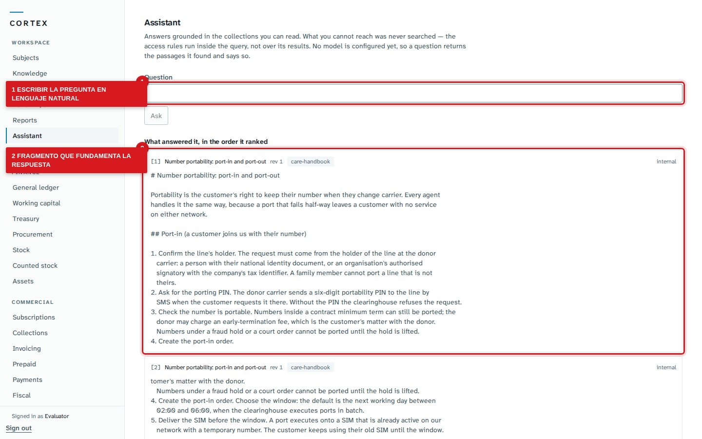

**Workspace → Assistant** **no** es una consola de consultas sobre la base de datos. Es
generación aumentada por recuperación (RAG) sobre esas colecciones y nada más: la pregunta se
compara contra los fragmentos que *esta cuenta puede leer* —la regla de acceso es parte del SQL
que busca, así que un fragmento que no puede leer nunca fue candidato—, se ordena con la
búsqueda de texto de PostgreSQL sobre las palabras con contenido de la pregunta, se reordena con
un modelo de embeddings local, y se muestra con su documento, revisión, colección, clasificación
y posición. Sin un modelo configurado, esa es la respuesta: **Passages found — no model was
asked** (fragmentos encontrados, no se consultó ningún modelo). Con uno
([Recorrido 6](#recorrido-6--un-modelo-para-el-asistente)), el modelo recibe esos fragmentos y
nada más.

Pregunte en lenguaje natural, en inglés, español o portugués. Cada una de estas preguntas se
hace contra el corpus en la suite de pruebas de la plataforma, y se fundamenta primero en el
documento indicado:

| Pregunta | Se fundamenta primero en |
| --- | --- |
| How do I port a number to another carrier? | Number portability: port-in and port-out |
| ¿Cuánto tarda la portabilidad numérica? | Portabilidad numérica: procedimiento para agentes |
| Qual é o prazo da portabilidade numérica? | Portabilidade numérica: procedimento para atendentes |
| What checks are required before replacing a SIM card? | SIM replacement and SIM-swap fraud controls |
| How is a billing dispute refunded? | Billing disputes, adjustments and refunds |
| Why was a prepaid call declined? | Prepaid balance, top-ups and credit authorisation |
| What credit do customers receive after an outage? | Service outages: customer communication and credits |
| Who declares a P1 major incident? | Major incident management (P1) |
| What is the data roaming bill shock cap? | Roaming: steering, fraud and bill-shock limits |
| How is an authorised electronic invoice cancelled? | Electronic invoicing: authorisation, cancellation and credit notes |
| How long are call detail records retained? | Personal data: retention, access and erasure |
| How often is the key-encryption key rotated? | Key management and rotation |

Una pregunta sin contenido —*¿qué es eso?*— no busca nada, y lo dice.

---

## Recorrido 4 — Control de acceso, visto desde el lado que protege

Abra una ventana privada e ingrese allí como **`agent`**. Mantenga al evaluador conectado en la
otra.

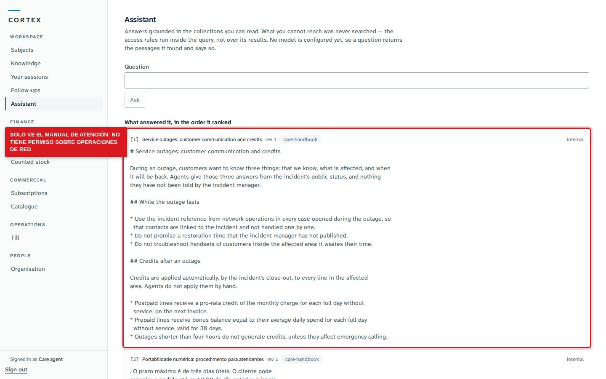

Como agente, pregunte **Who declares a P1 major incident?** La respuesta sale del manual de
atención —la página de cortes menciona incidentes— porque es la única colección etiquetada para
el personal. Los procedimientos de red nunca se buscaron.

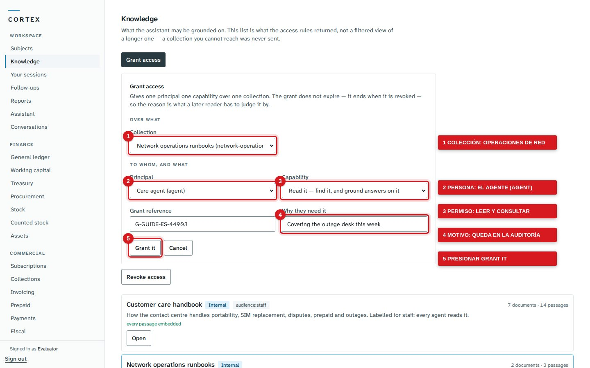

Como evaluador: **Knowledge**, **Open** en *Network operations runbooks*, **Grant access**
(otorgar acceso):

| Campo | Ingresar |
| --- | --- |
| Collection | Network operations runbooks (network-operations) |
| Principal | Care agent (agent) |
| Capability | Read it — find it, and ground answers on it |
| Grant reference | `G-AGENT-NOC` (cualquier referencia no usada antes) |
| Why they need it | `Cubre la mesa de cortes esta semana` |

**Grant it** (otorgar).

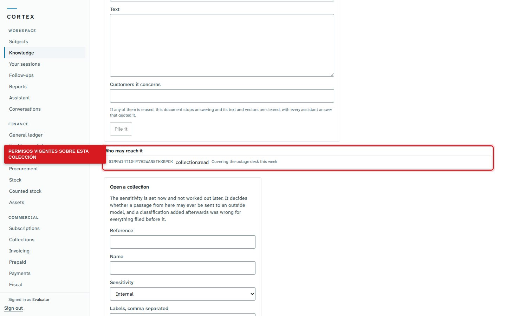

El permiso queda listado en la colección, con su motivo, y vale hasta que se revoque.

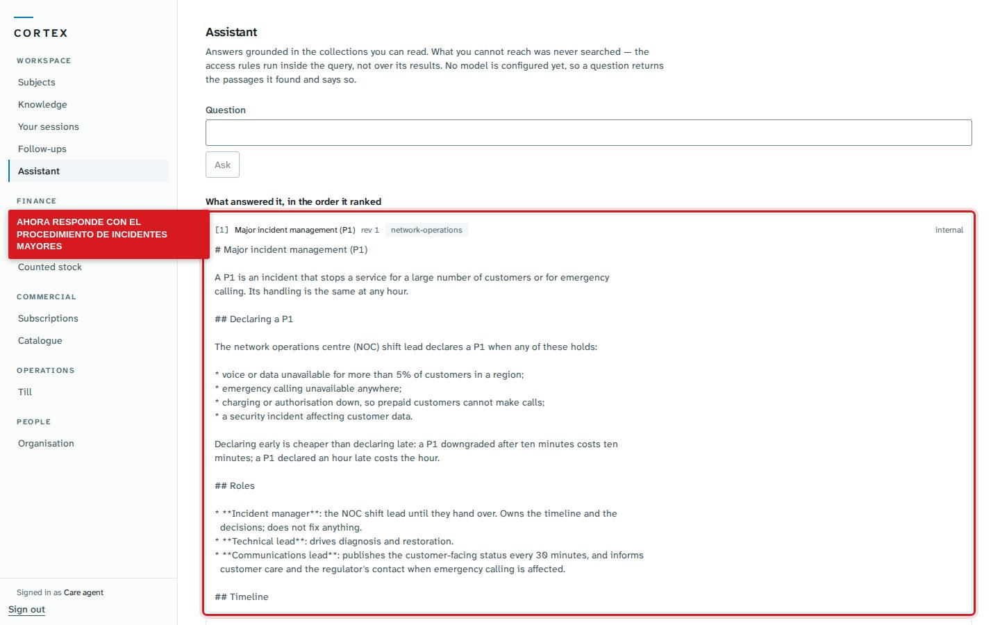

De vuelta en la ventana del agente, haga la misma pregunta. Ahora se fundamenta en **Major
incident management (P1)**. No se cacheó, reindexó ni copió nada: el permiso pasó a ser parte de
la regla de acceso con la que se compiló la búsqueda siguiente.

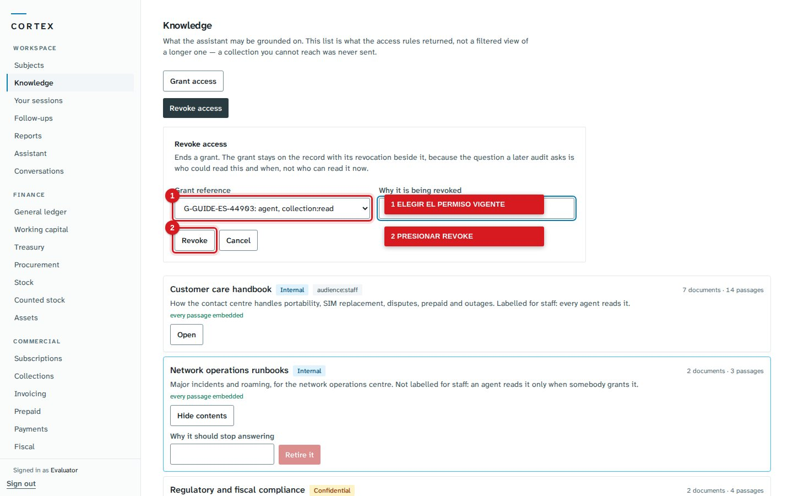

**Revoke access** (revocar acceso), elija el permiso, indique un motivo, **Revoke**: la
siguiente respuesta del agente vuelve a salir del manual. El permiso y su revocación quedan en
el registro, porque la pregunta de una revisión de accesos es *quién podía leer esto en marzo*,
no quién puede leerlo hoy.

---

## Recorrido 5 — Claves de cifrado y auditoría

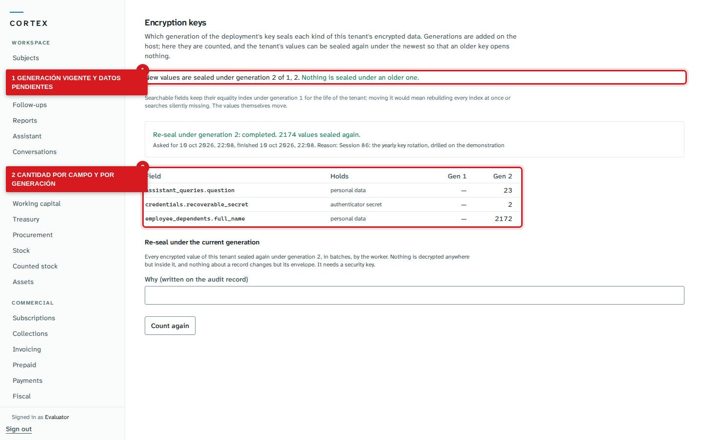

**Administration → Encryption keys** (claves de cifrado) muestra qué generación de la clave
maestra de la instalación protege cada tipo de dato personal, contado a partir de los
encabezados de los valores cifrados: no se descifra nada para contarlo. En esta demostración ya
se practicó la rotación anual: la generación 2 protege todo, la generación 1 está retirada —se
conserva solo para abrir lo que guardan respaldos anteriores— y no queda nada bajo ella.

La rotación es un acto del operador del servidor: `cortexctl rotate-kek` agrega una generación,
cada valor de cada inquilino se vuelve a sellar con ella por lotes, sin cortar el servicio y sin
cambiar el contenido de ningún registro, y la generación anterior se retira solo cuando no queda
nada bajo ella. En una instalación propia, un administrador con una **llave de seguridad**
también puede pedir el re-sellado desde esta pantalla; el evaluador público no tiene esa
capacidad, porque un re-sellado es una carga que cualquiera podría iniciar a voluntad.

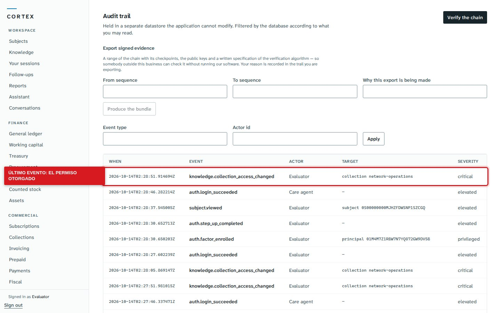

**Administration → Audit trail** (pide el segundo factor): cada cambio, en orden, encadenado por
hash por inquilino y firmado en puntos de control, de modo que un registro eliminado o alterado
rompe la cadena. El permiso del Recorrido 4 aparece arriba como
`knowledge.collection_access_changed`; los eventos `platform.keys_rotated` y
`platform.keys_resealed` de la rotación practicada están más abajo. Cada respuesta de la API
lleva un identificador de correlación, que figura en el registro que produjo.

---

## Recorrido 6 — Un modelo para el asistente

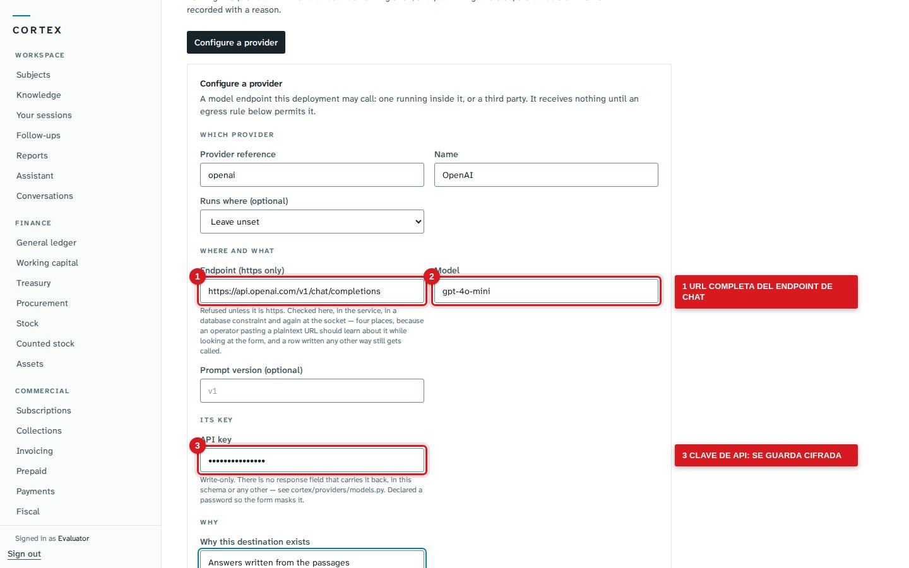

**Administration → AI providers → Configure a provider** (configurar un proveedor):

| Campo | Ingresar |
| --- | --- |
| Provider reference | `openai` |
| Name | `OpenAI` |
| Runs where | Hosted |
| Endpoint (https only) | La URL completa de chat completions, p. ej. `https://api.openai.com/v1/chat/completions`: cualquier endpoint compatible con OpenAI |
| Model | Un modelo que su cuenta ofrezca |
| API key | Su clave. Se cifra al llegar y ningún endpoint la devuelve |
| Why this destination exists | `Respuestas redactadas a partir de los fragmentos` |


Un proveedor sin regla **no recibe nada**. Dele una: referencia `openai`, **May receive** (puede
recibir) *Up to internal* (hasta interno), y un motivo. Luego, en **Assistant**, elíjalo en
**Answer with** (responder con) y pregunte. El modelo recibe solo los fragmentos que esta cuenta
puede leer *y* cuya sensibilidad la regla permite: pregunte por facturación electrónica y los
fragmentos confidenciales de la colección regulatoria quedan **retenidos** —contados en la
respuesta, nunca enviados.

> Esta es una demostración compartida. Una clave que agregue puede ser usada por el próximo
> evaluador hasta la restauración nocturna. Use una con tope de gasto y **retire** el proveedor
> al terminar.

---

## Recorrido 7 — Webhooks hacia un receptor suyo

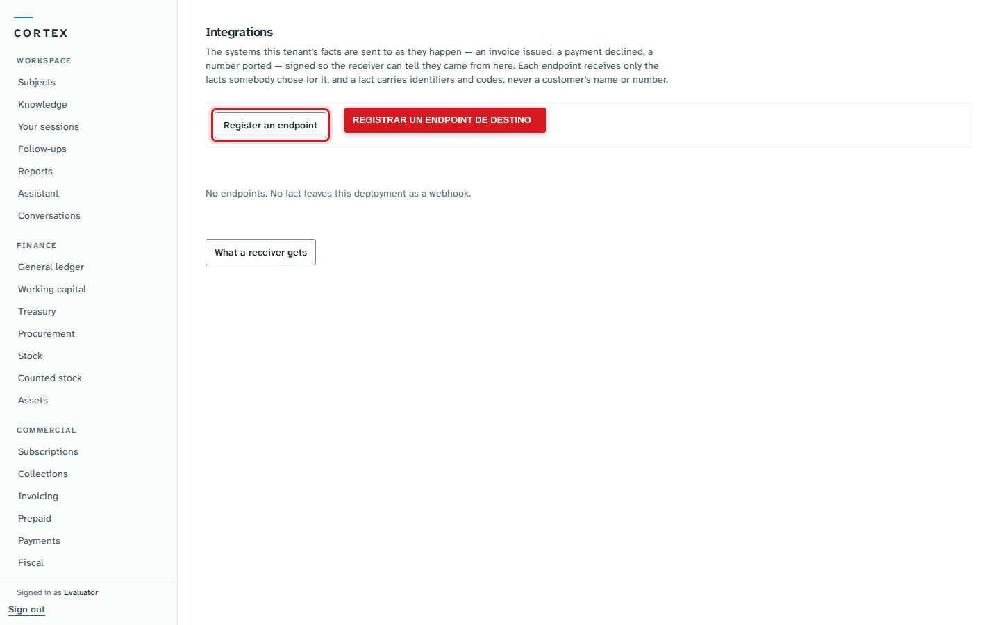

**Administration → Integrations → Register an endpoint** (registrar un endpoint): una URL
`https` pública que usted controle (una dirección privada o de enlace local se rechaza antes de
enviar nada), los eventos que recibe y un motivo. Guarde el secreto de firma, que se muestra una
sola vez. **Send a test ping** (enviar una prueba) entrega un evento firmado; las entregas del
endpoint muestran cada intento con su estado y su tiempo, y una entrega fallida puede reenviarse
indicando un motivo. Verifique una entrega con el SDK de este repositorio —tres líneas en Python,
TypeScript o Go— o ejecute antes `python examples/smoke.py python`, localmente.

---

## Recorrido 8 — Sus sesiones

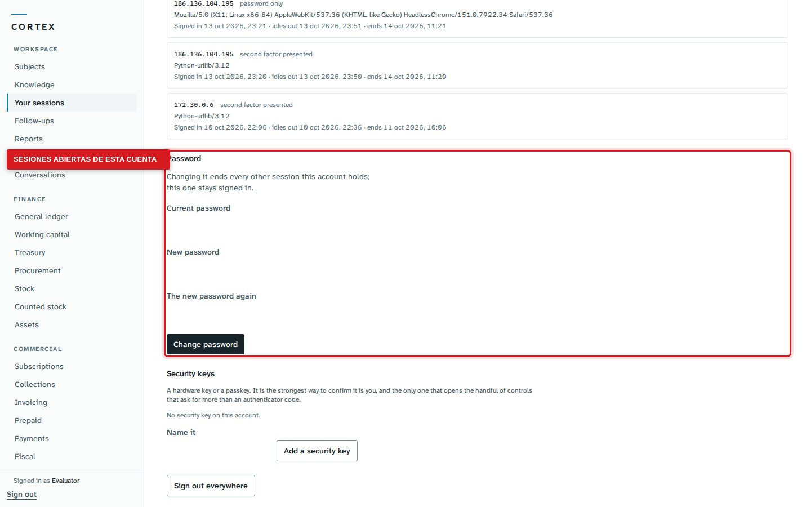

**Workspace → Your sessions** (sus sesiones): dónde está abierta esta cuenta. En una cuenta de
una instalación propia, aquí también una persona cambia su contraseña —demostrando la actual— y
cierra todas sus otras sesiones. En las cuentas publicadas el cambio se rechaza, con el motivo:
su ingreso lo administra la instalación, para que un evaluador no pueda dejar afuera al
siguiente.

---

## Por la API

```bash
python examples/evaluate/journey.py
```

Cada recorrido de esta guía, por la API que usan las pantallas, desde una sesión atada a una
clave que genera el script: ingreso, elevación, personas, la vista del cliente, el corpus, el
asistente fundamentado, el agente antes y después de un permiso, las generaciones de clave, la
auditoría y el catálogo de webhooks. La API está documentada en
[`api/openapi.json`](../api/openapi.json) y [`docs/integrating.md`](integrating.md).

## Qué se restaura cada noche

Toda la demostración —ambas bases de datos— se restaura a la misma instantánea cada noche: lo
que cree, otorgue, configure o rompa desaparece a la mañana siguiente, y el próximo evaluador
encuentra los mismos primeros cinco minutos que usted.
