# Evaluating Cortex — the live demonstration, step by step

**English** · [Español](evaluation-runbook.es.md) · [Português](evaluation-runbook.pt.md) · Quick guide: [EN](cortex-basic-guide.pdf) · [ES](guia-basica-cortex.pdf) · [PT](guia-basico-cortex.pdf)

For the evaluator, the architect and the executive who has five minutes or an afternoon.
Every step below was performed on [cortex.gonzaloromeroai.com](https://cortex.gonzaloromeroai.com),
and every screenshot was captured from it by a script that signs in as you will — the red
outlines and numbers are the only thing added. Nothing here needs anything installed, and
nothing you do can break the demonstration: it is restored to the same state every night.

`python examples/evaluate/journey.py` performs every journey below over the API the screens
use and prints PASS or FAIL for each claim this page makes. Run it first if you would rather
check the claims than read them.

---

## Before you start

Two public accounts, both in the organisation **`carrier-large`** — a carrier of about
900,000 customers, the largest of the three on this installation. Their passwords and the
evaluator's authenticator secret are in the [README](../README.md#evaluating-the-live-demonstration).

| Account | What it is | Use it to |
| --- | --- | --- |
| `evaluator` | An administrator, with six things withheld: managing people and roles, resetting others' credentials, impersonation, and the key re-seal | See every screen and do almost everything an administrator does |
| `agent` | An employee — a contact-centre agent | Watch the access rules from the side they protect |

A few actions ask for a second factor. When one does, the code is
`python examples/evaluate/totp.py` — the published secret, RFC 6238, printed with the seconds
it has left — or any authenticator app given the secret.

### The five-minute path

1. Sign in as `evaluator` ([Journey 1](#journey-1--sign-in-and-session-elevation)).
2. **Customers**, type `Subject 000` ([Journey 2](#journey-2--subjects-and-the-customer-overview)).
3. **Assistant**, ask *How do I port a number to another carrier?* ([Journey 3](#journey-3--knowledge-and-the-grounded-assistant)).
4. Grant the agent one collection and watch its answers change ([Journey 4](#journey-4--access-control-watched-from-the-side-it-protects)).
5. **Audit trail**: the grant you just made is at the top ([Journey 5](#journey-5--encryption-keys-and-the-audit-trail)).

---

## Journey 1 — Sign-in and session elevation

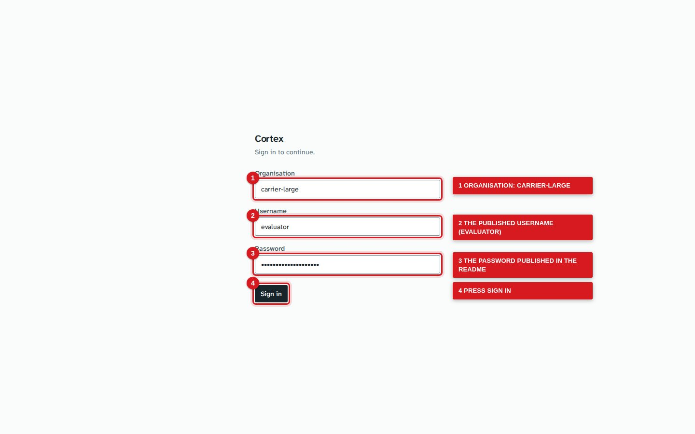

1. **Organisation** `carrier-large`, **Username** `evaluator`, **Password** from the README.
2. **Sign in.**

The session you receive is bound to a key your browser generated and never sent (DPoP,
RFC 9449): the access token alone is useless to anybody who copies it. The account's sign-in is
*managed by the deployment* — you will not be asked to change the password, and nobody can lock
it, change it, or sign everybody else out from inside.

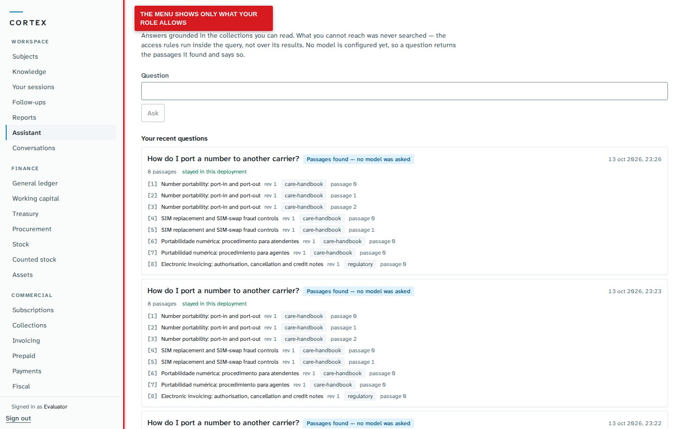

The navigation is grouped by area — Workspace, Customers, Commercial, Finance, Operations,
People, Administration — and shows only what this account may use. A screen you may not use is
not greyed out; it is absent, and so is the request that would have been refused.

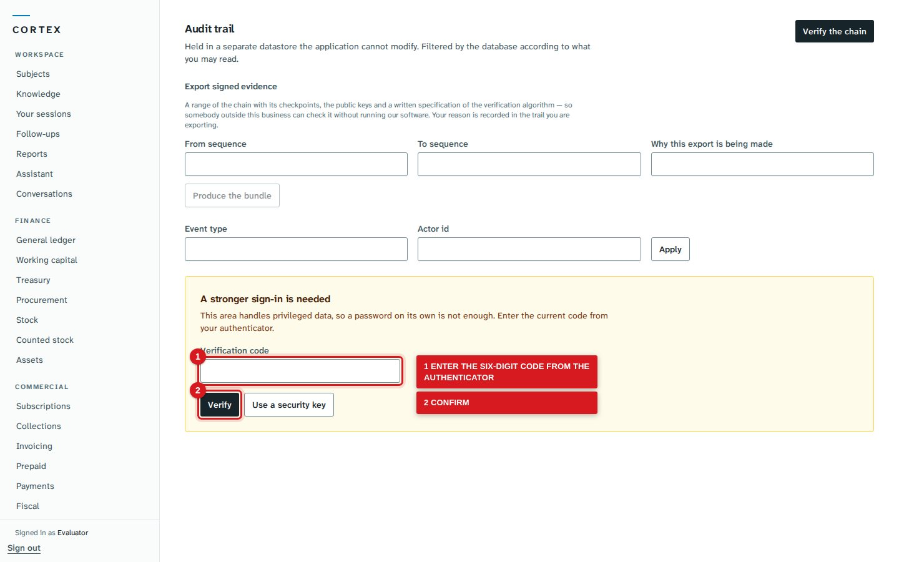

**Audit trail** needs assurance level 2. The screen asks for a **Verification code**: run
`python examples/evaluate/totp.py`, type the six digits, **Confirm**. The session is raised in
place, for this session only; nothing else you had open is affected. (Re-sealing every
encrypted value needs level 3 — a security key — which is one reason the public evaluator does
not hold it.)

---

## Journey 2 — Subjects and the customer overview

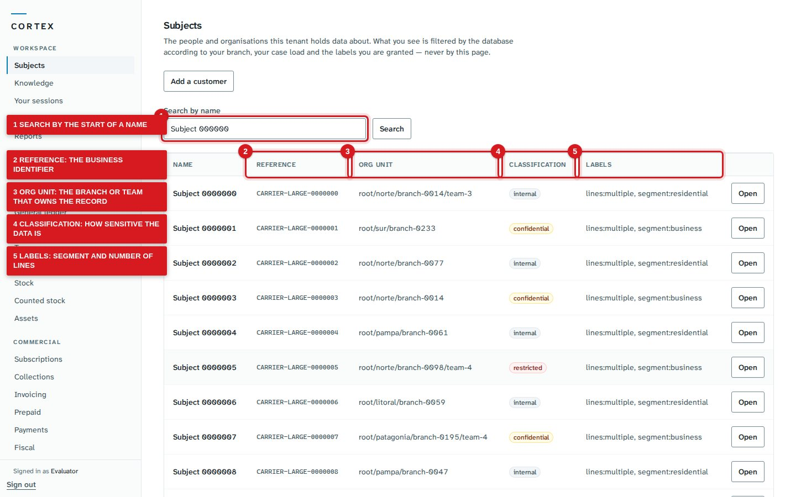

**Workspace → Subjects** is every person and organisation the tenant holds — customers,
prospects, employees' records — not only the ones who buy something. Search by the start of a
name: `Subject 000000`.

| Column | What it is | Why it is there |
| --- | --- | --- |
| **Reference** | The business identifier, `CARRIER-LARGE-0000000` | What other systems and people quote; the internal identifier is a ULID nobody reads |
| **Org unit** | Where the record lives: `root/norte/branch-0014/team-3` | The tenant is five regions, ~250 branches and their teams. Managers and agents see the records of their own unit and below; the column is what that rule reads |
| **Classification** | `internal`, `confidential` or `restricted` | Who may see the record's personal data, and whether anything about it may ever be sent to an outside model |
| **Labels** | `segment:residential`, `segment:business`, `lines:multiple` | Segments set on customers holding lines. A label can also be a role's constraint — a role may read only subjects labelled for it |

The 900,000 are segmented like a real operator's book because row-level access control is only
demonstrated by a tenant with rows in many places: a branch manager in `root/sur` sees
`root/sur` and nothing of `root/norte`, and every list on every screen is filtered inside the
SQL rather than after it.

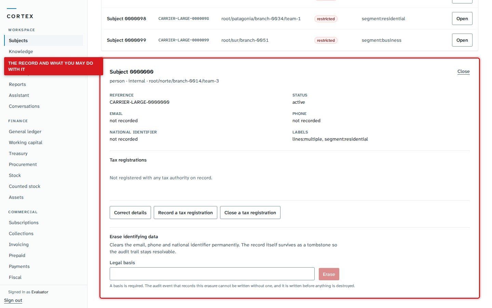

**Open** a row: its details and the actions this account may take on it, decided by the server
for that row. Personal data a role may not read is masked by the server, not by the screen: the
unmasked value never reaches a browser that may not show it.

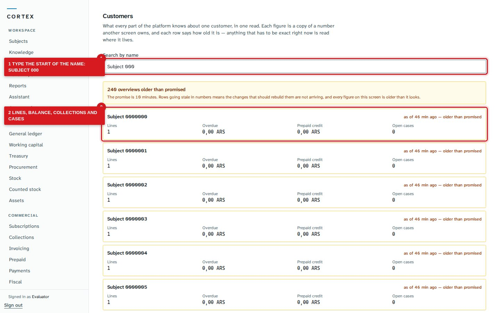

**Customers → Customers** is the overview an agent answers a call from: each customer's active
and barred lines, outstanding balance, credit, collections status and open cases, on one row,
in one indexed read. Type **the start of a name** — `Subject 000`, `Subject 0000123` — the
match is a case-insensitive prefix, the query that uses the index on a 900,000-row tenant; a
search for a fragment in the middle of a name is not offered, because it cannot be fast. The
overview holds the customers who hold lines — 240 in `carrier-large` — and every one shows how
fresh its row is.

---

## Journey 3 — Knowledge and the grounded assistant

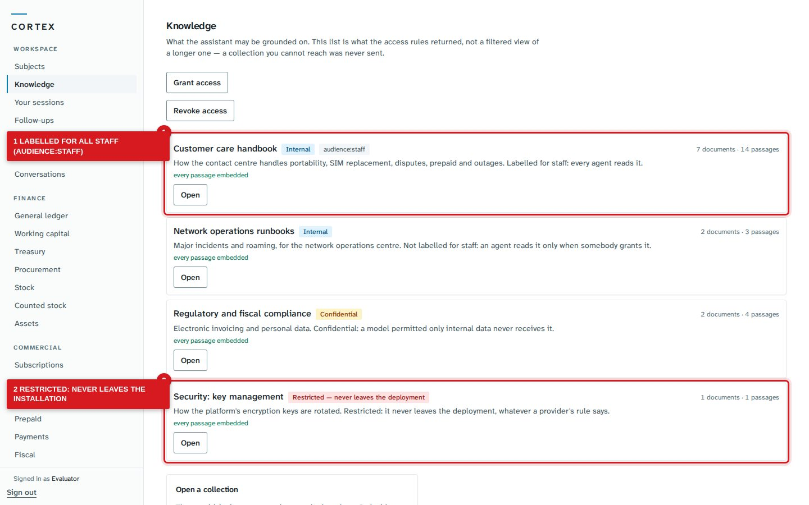

**Workspace → Knowledge** lists the collections the assistant may be grounded on — as the access
rules returned them, not a filtered view of a longer list. The demonstration ships four, of
real operational documents, at four sensitivities:

| Collection | Sensitivity | Holds | Reached by |
| --- | --- | --- | --- |
| `care-handbook` | internal, labelled `audience:staff` | Portability (in English, Spanish and Portuguese), SIM replacement and SIM-swap fraud, billing disputes, prepaid, outage credits | Every employee |
| `network-operations` | internal | Major incidents, roaming | Administrators, or a grant |
| `regulatory` | confidential | Electronic invoicing, personal data | Administrators, or a grant; never a model allowed only internal data |
| `security` | restricted | Key management and rotation | Administrators, or a grant; never leaves the deployment |

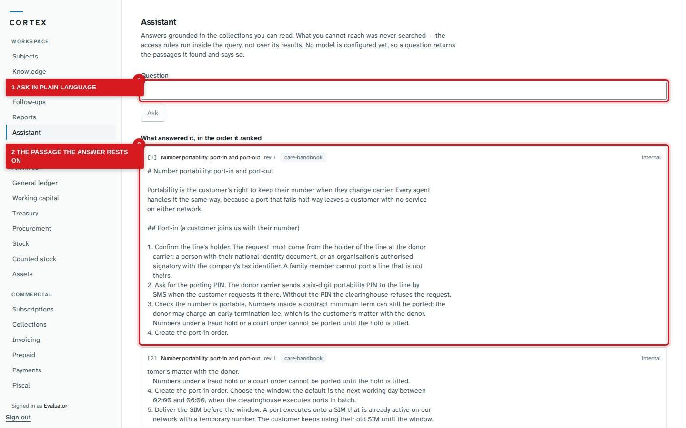

**Workspace → Assistant** is **not** a query console over the database. It is retrieval-augmented
generation over those collections, and nothing else: a question is matched against the passages
*this account may read* — the access rule is part of the SQL that searches, so a passage you may
not read was never a candidate — ranked by PostgreSQL's text search on the question's topic
words, reranked by a local embedding model, and shown with its document, revision, collection,
classification and rank. With no model configured, that is the answer: **Passages found — no model
was asked**. With one ([Journey 6](#journey-6--a-model-for-the-assistant)), the model is given those
passages and nothing else.

Ask in plain language, in English, Spanish or Portuguese. Each of these is asked against the corpus in the
platform's test suite, and grounds first on the document named:

| Ask | Grounds first on |
| --- | --- |
| How do I port a number to another carrier? | Number portability: port-in and port-out |
| ¿Cuánto tarda la portabilidad numérica? | Portabilidad numérica: procedimiento para agentes |
| Qual é o prazo da portabilidade numérica? | Portabilidade numérica: procedimento para atendentes |
| What checks are required before replacing a SIM card? | SIM replacement and SIM-swap fraud controls |
| How is a billing dispute refunded? | Billing disputes, adjustments and refunds |
| Why was a prepaid call declined? | Prepaid balance, top-ups and credit authorisation |
| What credit do customers receive after an outage? | Service outages: customer communication and credits |
| Who declares a P1 major incident? | Major incident management (P1) |
| What is the data roaming bill shock cap? | Roaming: steering, fraud and bill-shock limits |
| How is an authorised electronic invoice cancelled? | Electronic invoicing: authorisation, cancellation and credit notes |
| How long are call detail records retained? | Personal data: retention, access and erasure |
| How often is the key-encryption key rotated? | Key management and rotation |

A question with no topic in it — *what is it?* — searches nothing, and says so.

---

## Journey 4 — Access control, watched from the side it protects

Open a private window and sign in there as **`agent`**. Keep the evaluator signed in in the
other.

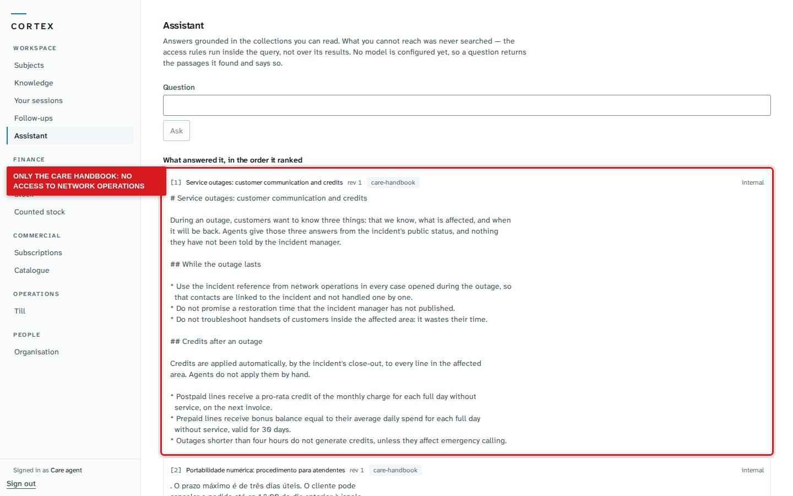

As the agent, ask **Who declares a P1 major incident?** The answer comes from the care handbook
— the outage page mentions incidents — because that is the only collection labelled for staff.
The network runbooks were never searched.

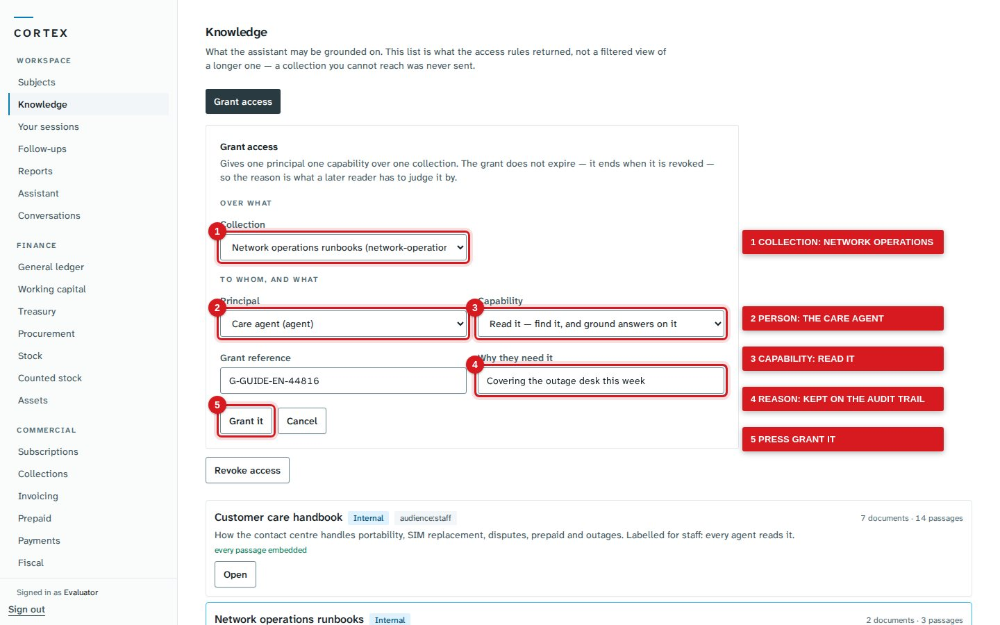

As the evaluator: **Knowledge**, **Open** on *Network operations runbooks*, **Grant access**:

| Field | Enter |
| --- | --- |
| Collection | Network operations runbooks (network-operations) |
| Principal | Care agent (agent) |
| Capability | Read it — find it, and ground answers on it |
| Grant reference | `G-AGENT-NOC` (any reference not used before) |
| Why they need it | `Covering the outage desk this week` |

**Grant it.**

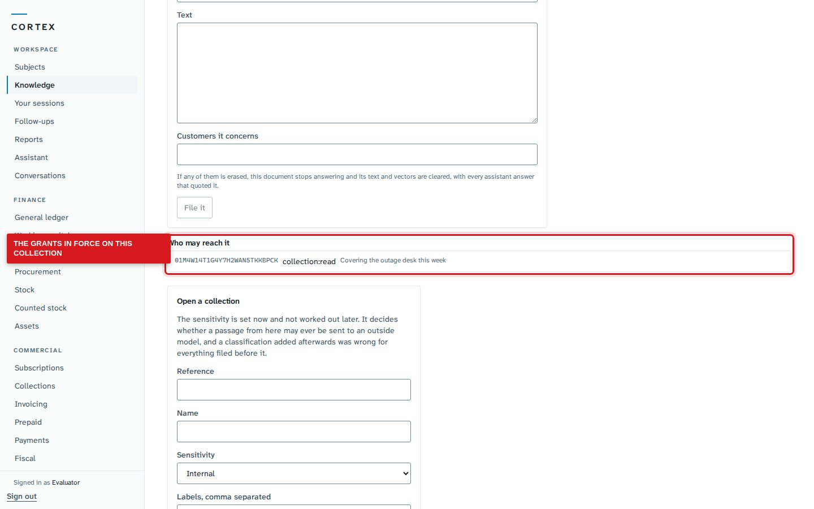

The grant is listed on the collection, with its reason, and holds until revoked.

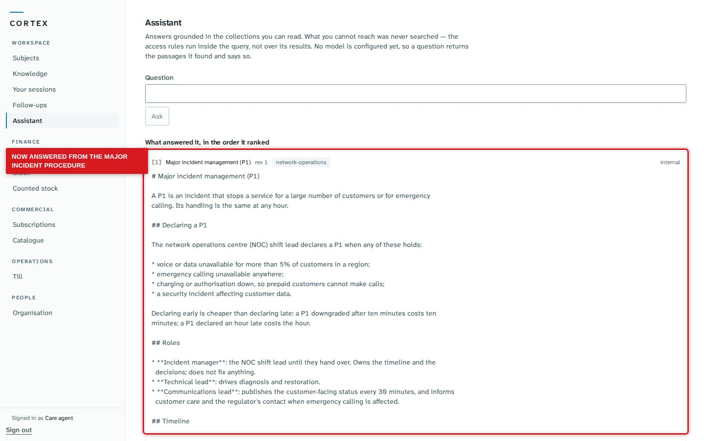

Back in the agent's window, ask the same question. It is now grounded on **Major incident
management (P1)**. Nothing was cached, re-indexed or copied: the grant became part of the
access rule the next search was compiled with.

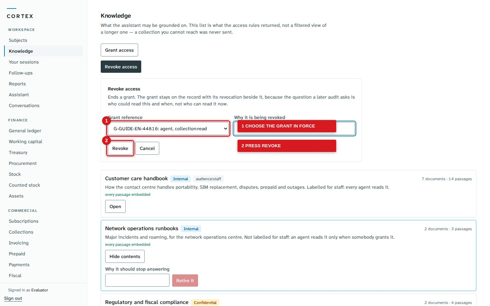

**Revoke access**, choose the grant, give a reason, **Revoke** — and the agent's next answer
comes from the handbook again. The grant and its revocation both stay on the record, because the
question an access review asks is *who could read this in March*, not who can read it now.

---

## Journey 5 — Encryption keys and the audit trail

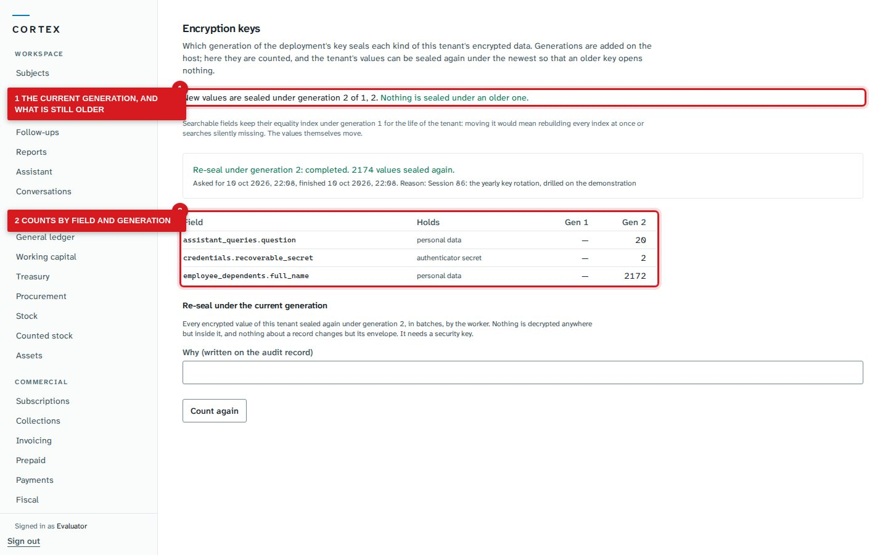

**Administration → Encryption keys** shows which generation of the deployment's key-encryption
key seals each kind of personal data, counted from the encrypted values' headers — nothing is
decrypted to count it. On this demonstration the yearly rotation has been drilled: generation 2
seals everything, generation 1 is retired — kept only to open what older backups hold — and
nothing is left under it.

The rotation itself is the host operator's act: `cortexctl rotate-kek` adds a generation, every
value of every tenant is sealed again under it in batches, without downtime and without changing
any record's content, and the old generation is retired only when nothing remains under it. On
an installation of your own, an administrator with a **security key** can also ask for a
re-seal from this screen; the public evaluator does not hold that capability, because a re-seal
is a load anybody could otherwise start at will.

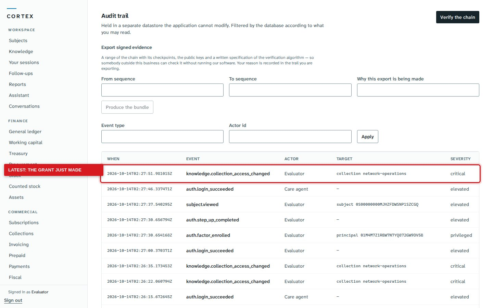

**Administration → Audit trail** (it asks for the second factor): every change, in order,
hash-chained per tenant and signed at checkpoints, so a record removed or altered breaks the
chain. The grant you made in Journey 4 is at the top as `knowledge.collection_access_changed`;
the drill's `platform.keys_rotated` and `platform.keys_resealed` are further down. Every
response the API sends carries a correlation id; it is on the record it produced.

---

## Journey 6 — A model for the assistant

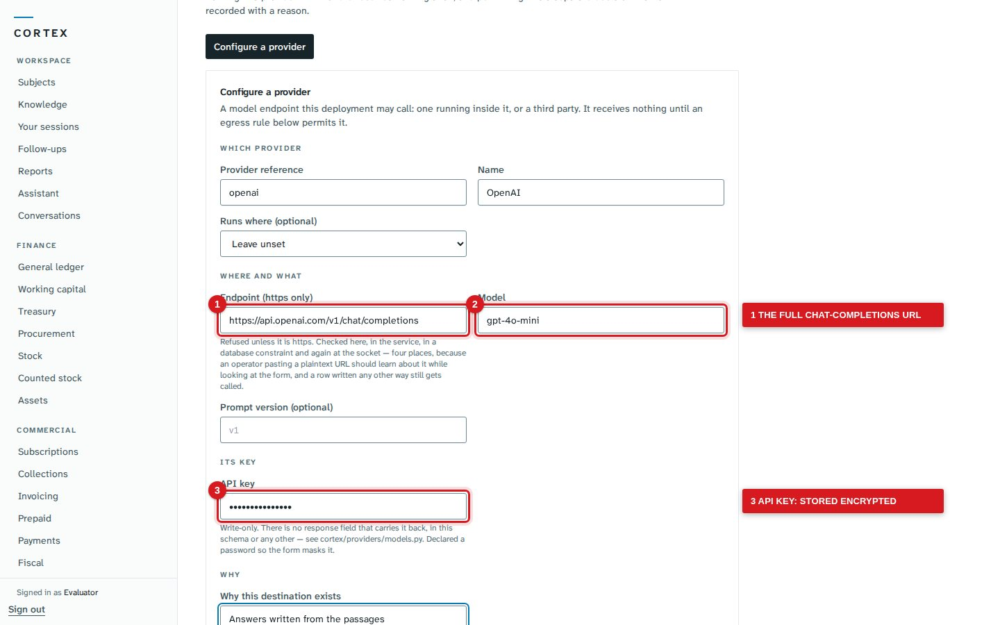

**Administration → AI providers → Configure a provider**:

| Field | Enter |
| --- | --- |
| Provider reference | `openai` |
| Name | `OpenAI` |
| Runs where | Hosted |
| Endpoint (https only) | The full chat-completions URL, e.g. `https://api.openai.com/v1/chat/completions` — any OpenAI-compatible endpoint |
| Model | A model your account offers |
| API key | Your key. It is sealed on arrival and never returned by any endpoint |
| Why this destination exists | `Answers written from the passages` |


A provider with no rule receives **nothing**. Give it one: provider reference `openai`, **May
receive** *Up to internal*, and a reason. Then, on the **Assistant**, choose it under **Answer
with** and ask. The model is given only the passages this account may read *and* whose
sensitivity the rule allows: ask about electronic invoicing, and the confidential regulatory
passages are **withheld** — counted on the answer, never sent.

> This is a shared demonstration. A key you add can be used by the next evaluator until the
> nightly restore. Use one with a spending cap, and **Retire** the provider when you are done.

---

## Journey 7 — Webhooks to a receiver of yours

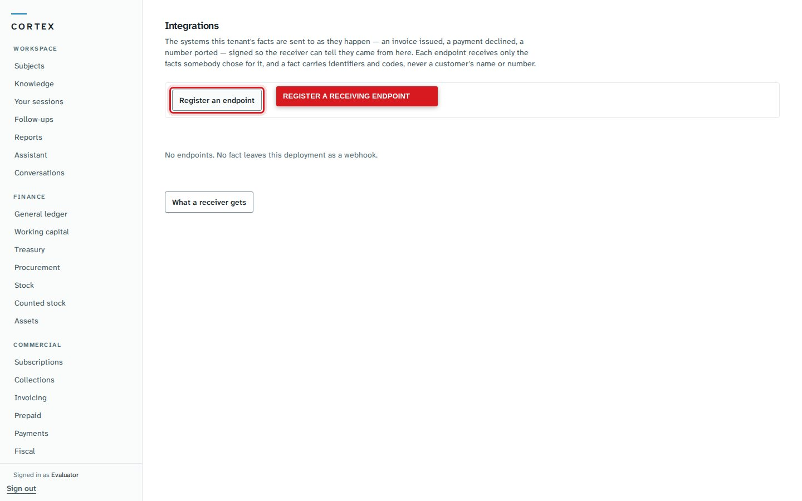

**Administration → Integrations → Register an endpoint**: a public `https` URL you control (a
private or link-local address is refused before anything is sent), the facts it receives, and a
reason. Keep the signing secret shown once. **Send a test ping** delivers a signed event; the
endpoint's deliveries show every attempt with its status and timing, and a dead one can be
replayed with a reason. Verify a delivery with the SDK in this repository — three lines in
Python, TypeScript or Go — or run `python examples/smoke.py python` first, locally.

---

## Journey 8 — Your sessions

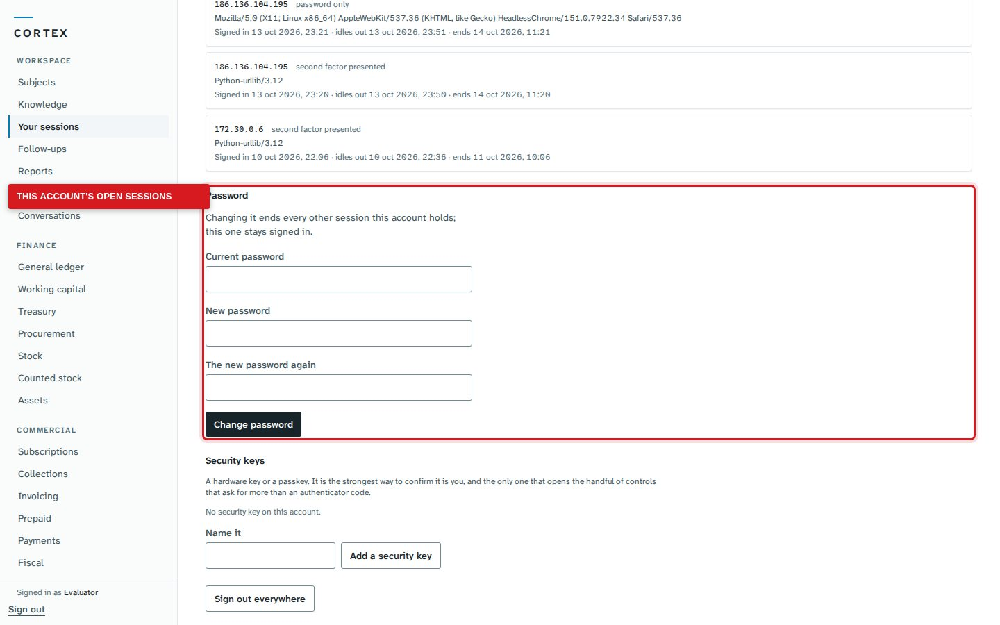

**Workspace → Your sessions**: where this account is signed in. On an account of your own
installation, this is also where a person changes their own password — proving the current one —
and ends every other session. On the published accounts the change is refused, with the
reason: their sign-in is managed by the deployment, so one evaluator cannot lock out the next.

---

## Over the API

```bash
python examples/evaluate/journey.py
```

Every journey above, over the API the screens use, from a session bound to a key the script
generates — sign-in, step-up, subjects, the customer overview, the corpus, the grounded
assistant, the agent before and after a grant, the key generations, the audit trail and the
webhook catalogue. The API is documented in [`api/openapi.json`](../api/openapi.json) and
[`docs/integrating.md`](integrating.md).

## What is restored every night

The whole demonstration — both databases — is restored to the same snapshot every night:
anything you create, grant, configure or break is gone the next morning, and the next evaluator
meets the same first five minutes you did.
