# Avaliar o Cortex — a demonstração ao vivo, passo a passo

[English](evaluation-runbook.md) · [Español](evaluation-runbook.es.md) · **Português** · Guia rápido: [EN](cortex-basic-guide.pdf) · [ES](guia-basica-cortex.pdf) · [PT](guia-basico-cortex.pdf)

Para quem avalia, para a arquitetura e para a diretoria, tenham cinco minutos ou uma tarde. Cada
passo deste guia foi feito em [cortex.gonzaloromeroai.com](https://cortex.gonzaloromeroai.com),
e cada captura foi tirada da plataforma por um script que entra como você vai entrar: os
contornos vermelhos, os números e as notas são a única coisa acrescentada. Não é preciso instalar
nada, e nada do que você fizer pode quebrar a demonstração: ela é restaurada ao mesmo estado
todas as noites.

A interface está em inglês; os nomes de telas e botões aparecem aqui exatamente como na tela,
com o sentido em português.

`python examples/evaluate/journey.py` executa cada roteiro deste guia pela mesma API que as
telas usam e imprime PASS ou FAIL para cada afirmação. Rode-o primeiro se preferir conferir em
vez de ler.

---

## Antes de começar

Duas contas públicas, ambas na organização **`carrier-large`**: uma operadora de
telecomunicações com cerca de 900.000 clientes, a maior das três desta instalação. As senhas e o
segredo do autenticador do avaliador estão no
[README](../README.md#evaluating-the-live-demonstration).

| Conta | O que é | Para que usar |
| --- | --- | --- |
| `evaluator` | Um administrador com seis coisas retidas: administrar pessoas e perfis, redefinir credenciais alheias, personificar usuários e a re-selagem de chaves | Ver todas as telas e fazer quase tudo o que um administrador faz |
| `agent` | Um funcionário: um atendente de central de atendimento | Ver as regras de acesso do lado que elas protegem |

Algumas ações pedem um segundo fator. Quando isso acontecer, o código vem de
`python examples/evaluate/totp.py` — o segredo publicado, RFC 6238, com os segundos que lhe
restam — ou de qualquer aplicativo autenticador configurado com o segredo.

### O roteiro de cinco minutos

1. Entrar como `evaluator` ([Roteiro 1](#roteiro-1--entrada-e-elevação-da-sessão)).
2. **Customers**, digitar `Subject 000` ([Roteiro 2](#roteiro-2--pessoas-e-visão-do-cliente)).
3. **Assistant**, perguntar *Qual é o prazo da portabilidade numérica?* ([Roteiro 3](#roteiro-3--conhecimento-e-assistente-fundamentado)).
4. Dar ao atendente acesso a uma coleção e ver suas respostas mudarem ([Roteiro 4](#roteiro-4--controle-de-acesso-visto-do-lado-que-ele-protege)).
5. **Audit trail**: a permissão recém-concedida aparece no topo ([Roteiro 5](#roteiro-5--chaves-de-criptografia-e-auditoria)).

---

## Roteiro 1 — Entrada e elevação da sessão

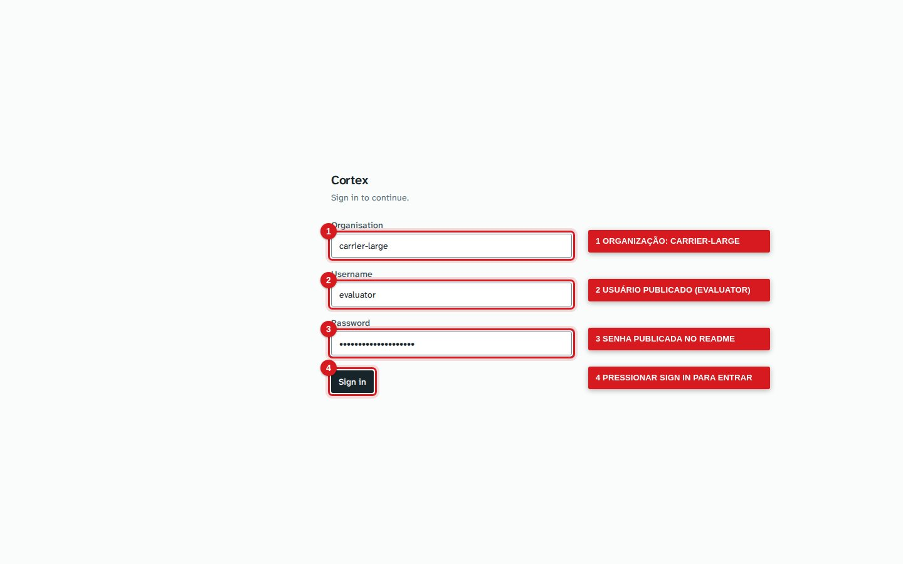

1. **Organisation** (organização) `carrier-large`, **Username** (usuário) `evaluator`,
   **Password** (senha) a do README.
2. **Sign in** (entrar).

A sessão que você recebe fica vinculada a uma chave que o seu navegador gerou e nunca enviou
(DPoP, RFC 9449): o token de acesso sozinho não serve a quem o copiar. A entrada desta conta é
*administrada pela instalação*: ninguém vai pedir que você troque a senha, e ninguém pode
bloqueá-la, alterá-la ou encerrar as sessões dos outros por dentro.

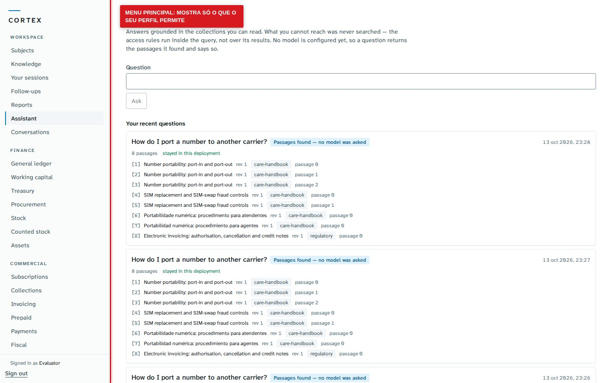

O menu é agrupado por área — Workspace, Customers, Commercial, Finance, Operations, People,
Administration — e mostra só o que esta conta pode usar. Uma tela que ela não pode usar não
aparece acinzentada: não aparece, e tampouco a requisição que seria recusada.

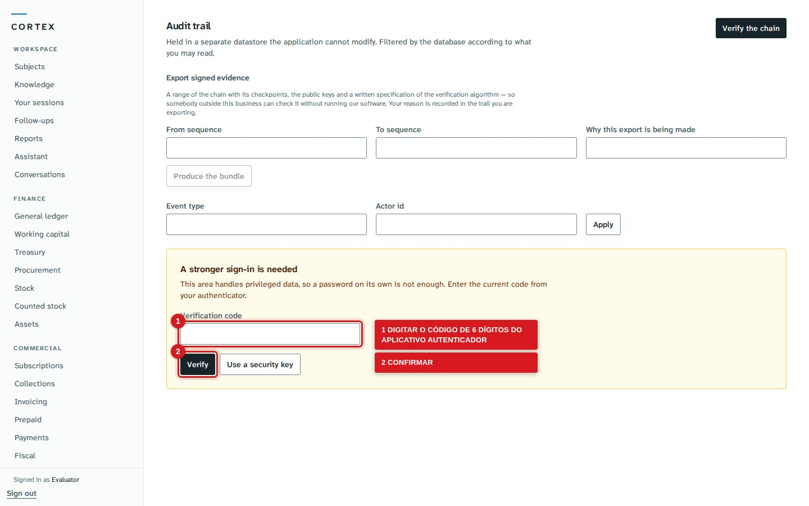

**Audit trail** (auditoria) exige nível de garantia 2. A tela pede um **Verification code**
(código de verificação): rode `python examples/evaluate/totp.py`, digite os seis dígitos e
confirme. A sessão é elevada ali mesmo, só esta sessão; nada do que estava aberto é afetado.
(Re-selar todos os valores cifrados exige nível 3 — uma chave de segurança —, um dos motivos de
o avaliador público não ter essa capacidade.)

---

## Roteiro 2 — Pessoas e visão do cliente

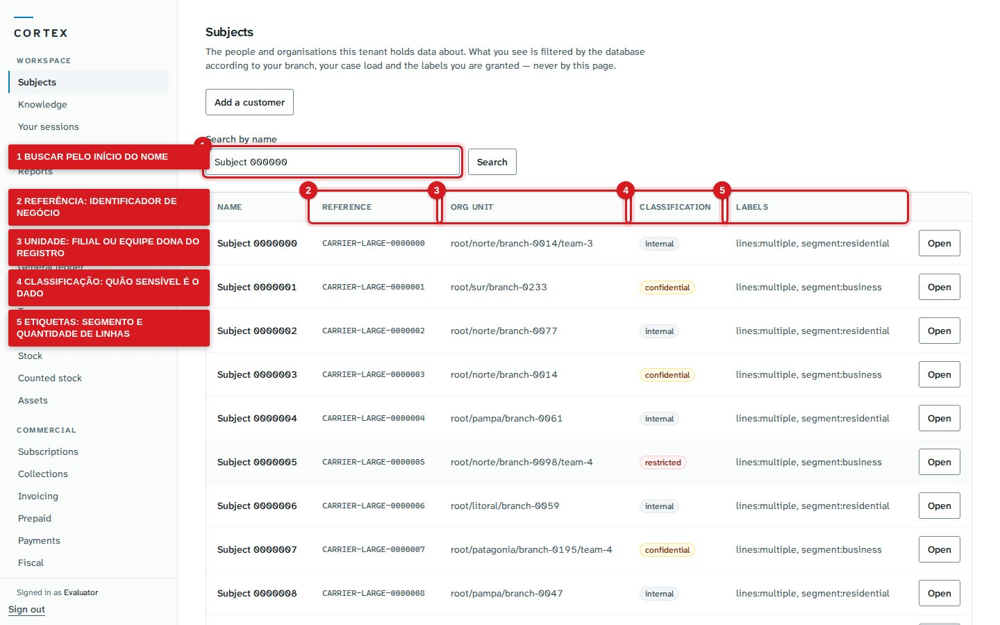

**Workspace → Subjects** são todas as pessoas e organizações que o inquilino registra —
clientes, prospects, registros de funcionários —, não só quem compra algo. A busca é pelo início
do nome: `Subject 000000`.

| Coluna | O que é | Por que está ali |
| --- | --- | --- |
| **Reference** | O identificador de negócio, `CARRIER-LARGE-0000000` | O que outros sistemas e as pessoas citam; o identificador interno é um ULID que ninguém lê |
| **Org unit** | Onde o registro vive: `root/norte/branch-0014/team-3` | O inquilino tem cinco regiões, ~250 filiais e suas equipes. Gerentes e atendentes veem os registros da sua unidade e das inferiores; a coluna é o que essa regra lê |
| **Classification** | `internal`, `confidential` ou `restricted` | Quem pode ver os dados pessoais do registro, e se algo dele pode algum dia chegar a um modelo externo |
| **Labels** | `segment:residential`, `segment:business`, `lines:multiple` | Segmentos dos clientes com linhas. Uma etiqueta também pode ser a restrição de um perfil: um perfil pode ler só os registros etiquetados para ele |

Os 900.000 estão segmentados como a carteira de uma operadora real porque o controle de acesso
por linha só se demonstra com um inquilino que tem linhas em muitos lugares: um gerente de
filial em `root/sur` vê `root/sur` e nada de `root/norte`, e cada lista de cada tela é filtrada
dentro do SQL, e não depois.

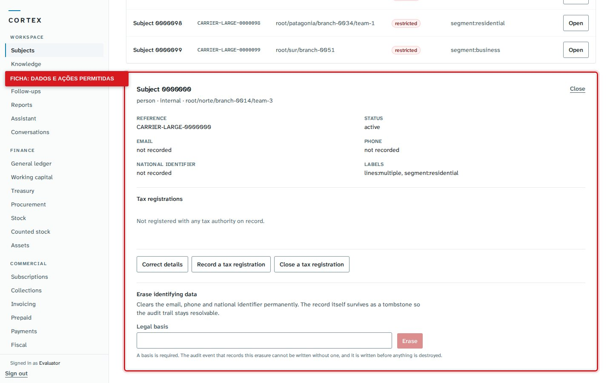

**Open** (abrir) numa linha: os seus dados e as ações que esta conta pode executar sobre ela,
decididas pelo servidor para aquela linha. Os dados pessoais que um perfil não pode ler são
mascarados pelo servidor, não pela tela: o valor sem máscara nunca chega a um navegador que não
pode exibi-lo.

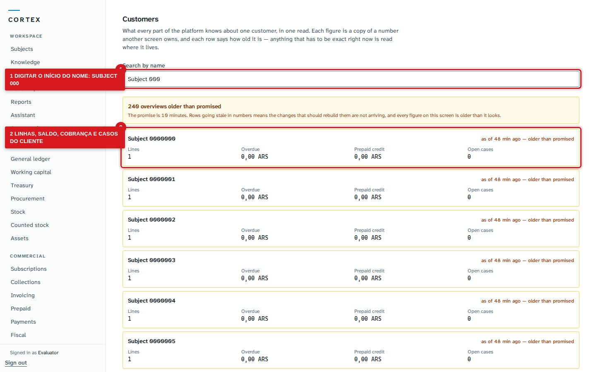

**Customers → Customers** é a visão a partir da qual um atendente atende uma ligação: as linhas
ativas e bloqueadas de cada cliente, o saldo devedor, o crédito, a situação de cobrança e os
casos abertos, numa só linha e numa só leitura indexada. Digite **o início de um nome** —
`Subject 000`, `Subject 0000123` —: a busca é por prefixo, sem diferenciar maiúsculas, que é a
consulta que usa o índice num inquilino de 900.000 linhas; não se oferece busca por um trecho no
meio do nome, porque ela não pode ser rápida. A visão contém os clientes que têm linhas — 240 em
`carrier-large` — e cada um mostra quão recente é a sua linha.

---

## Roteiro 3 — Conhecimento e assistente fundamentado

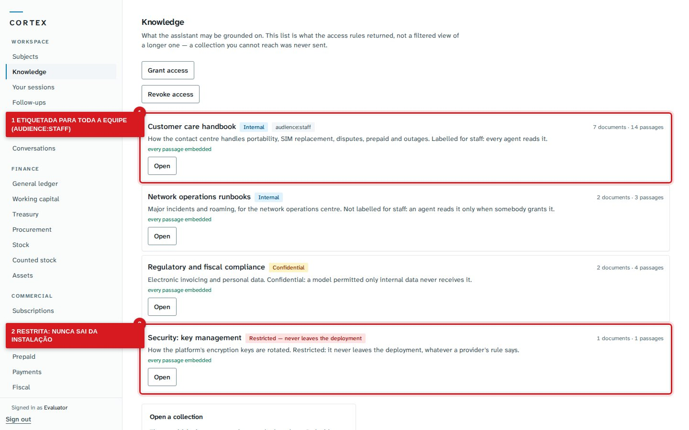

**Workspace → Knowledge** lista as coleções em que o assistente pode se fundamentar, como as
regras de acesso as devolveram: não é uma visão filtrada de uma lista maior. A demonstração traz
quatro, de documentos operacionais reais, em quatro níveis de sensibilidade:

| Coleção | Sensibilidade | Contém | Quem alcança |
| --- | --- | --- | --- |
| `care-handbook` | internal, etiquetada `audience:staff` | Portabilidade (em inglês, espanhol e português), troca de chip e fraude por SIM swap, contestações de fatura, pré-pago, créditos por interrupção | Todo funcionário |
| `network-operations` | internal | Incidentes graves, roaming | Administradores, ou uma permissão |
| `regulatory` | confidential | Faturamento eletrônico, dados pessoais | Administradores, ou uma permissão; nunca um modelo autorizado só para dados internos |
| `security` | restricted | Gestão e rotação de chaves | Administradores, ou uma permissão; nunca sai da instalação |

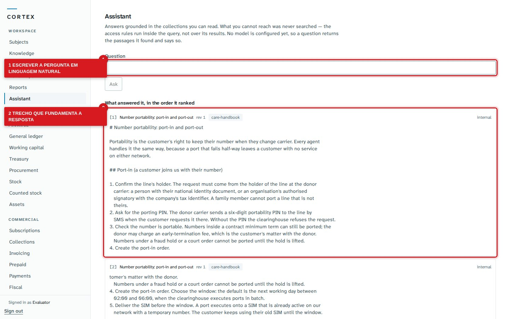

**Workspace → Assistant** **não** é um console de consultas sobre o banco de dados. É geração
aumentada por recuperação (RAG) sobre essas coleções e nada mais: a pergunta é comparada com os
trechos que *esta conta pode ler* — a regra de acesso faz parte do SQL que busca, então um trecho
que ela não pode ler nunca foi candidato —, ordenada pela busca de texto do PostgreSQL sobre as
palavras com conteúdo da pergunta, reordenada por um modelo de embeddings local, e exibida com
documento, revisão, coleção, classificação e posição. Sem um modelo configurado, essa é a
resposta: **Passages found — no model was asked** (trechos encontrados, nenhum modelo foi
consultado). Com um ([Roteiro 6](#roteiro-6--um-modelo-para-o-assistente)), o modelo recebe esses
trechos e nada mais.

Pergunte em linguagem natural, em inglês, espanhol ou português. Cada uma destas perguntas é
feita contra o corpus na suíte de testes da plataforma, e se fundamenta primeiro no documento
indicado:

| Pergunta | Fundamenta-se primeiro em |
| --- | --- |
| How do I port a number to another carrier? | Number portability: port-in and port-out |
| ¿Cuánto tarda la portabilidad numérica? | Portabilidad numérica: procedimiento para agentes |
| Qual é o prazo da portabilidade numérica? | Portabilidade numérica: procedimento para atendentes |
| What checks are required before replacing a SIM card? | SIM replacement and SIM-swap fraud controls |
| How is a billing dispute refunded? | Billing disputes, adjustments and refunds |
| Why was a prepaid call declined? | Prepaid balance, top-ups and credit authorisation |
| What credit do customers receive after an outage? | Service outages: customer communication and credits |
| Who declares a P1 major incident? | Major incident management (P1) |
| What is the data roaming bill shock cap? | Roaming: steering, fraud and bill-shock limits |
| How is an authorised electronic invoice cancelled? | Electronic invoicing: authorisation, cancellation and credit notes |
| How long are call detail records retained? | Personal data: retention, access and erasure |
| How often is the key-encryption key rotated? | Key management and rotation |

Uma pergunta sem conteúdo — *o que é isso?* — não busca nada, e diz isso.

---

## Roteiro 4 — Controle de acesso, visto do lado que ele protege

Abra uma janela anônima e entre nela como **`agent`**. Mantenha o avaliador conectado na outra.

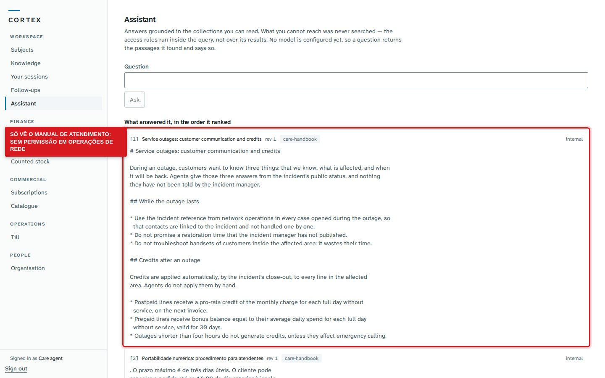

Como atendente, pergunte **Who declares a P1 major incident?** A resposta vem do manual de
atendimento — a página de interrupções menciona incidentes — porque é a única coleção etiquetada
para a equipe. Os procedimentos de rede nunca foram buscados.

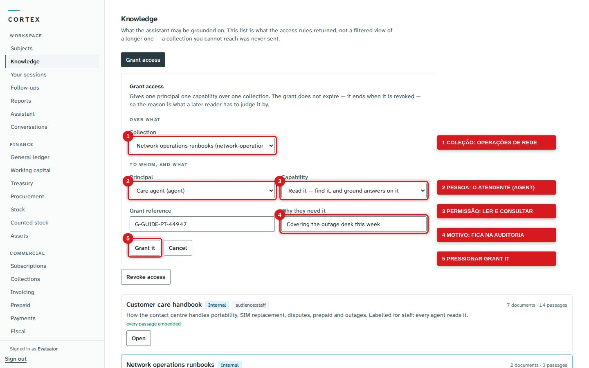

Como avaliador: **Knowledge**, **Open** em *Network operations runbooks*, **Grant access**
(conceder acesso):

| Campo | Digitar |
| --- | --- |
| Collection | Network operations runbooks (network-operations) |
| Principal | Care agent (agent) |
| Capability | Read it — find it, and ground answers on it |
| Grant reference | `G-AGENT-NOC` (qualquer referência ainda não usada) |
| Why they need it | `Cobre a mesa de interrupções nesta semana` |

**Grant it** (conceder).

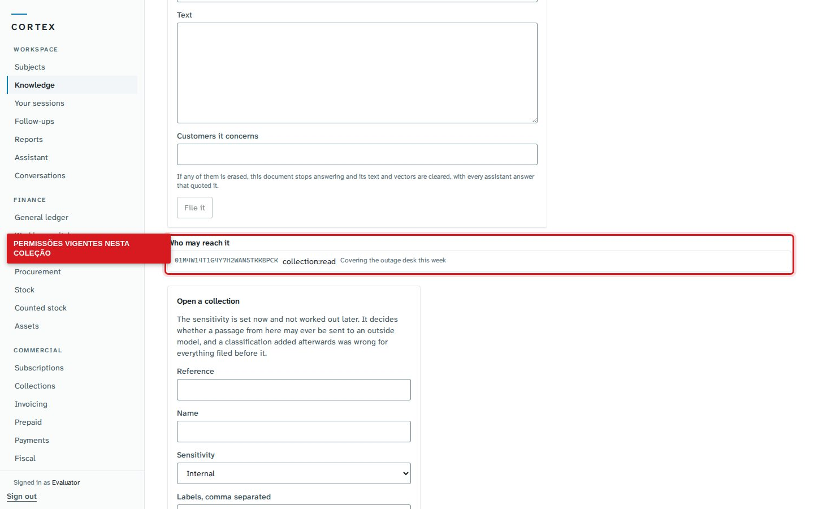

A permissão fica listada na coleção, com o seu motivo, e vale até ser revogada.

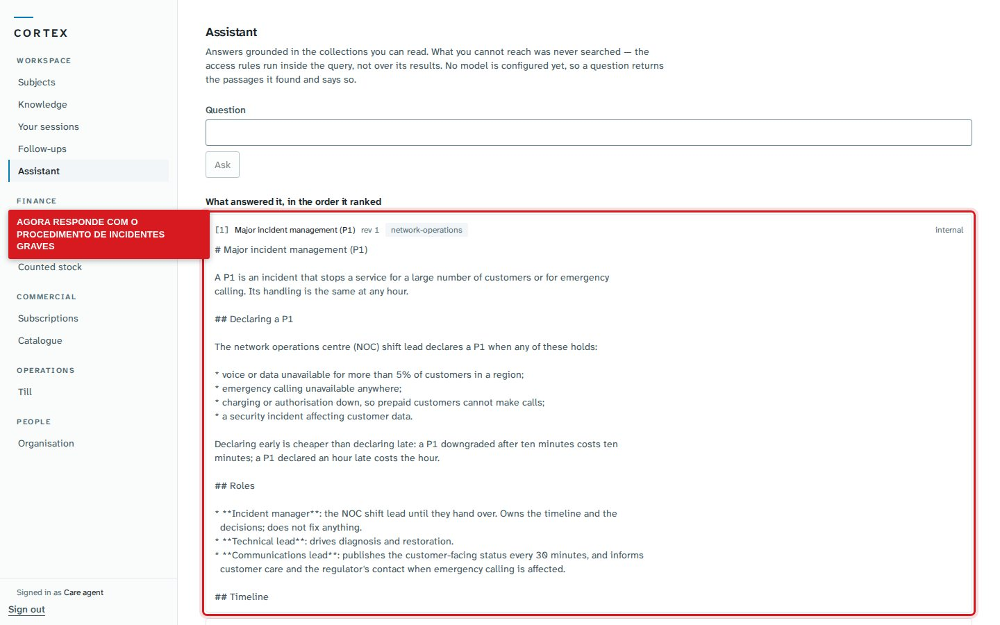

De volta à janela do atendente, faça a mesma pergunta. Agora ela se fundamenta em **Major
incident management (P1)**. Nada foi colocado em cache, reindexado ou copiado: a permissão passou
a fazer parte da regra de acesso com que a busca seguinte foi compilada.

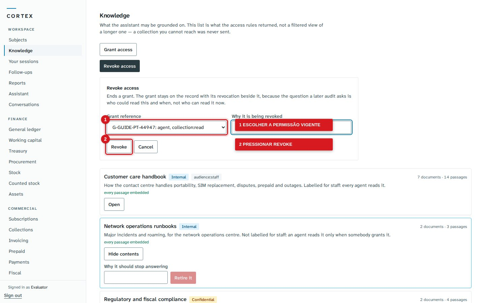

**Revoke access** (revogar acesso), escolha a permissão, informe um motivo, **Revoke**: a
resposta seguinte do atendente volta a vir só do manual. A permissão e a sua revogação ficam no
registro, porque a pergunta de uma revisão de acessos é *quem podia ler isto em março*, não quem
pode ler hoje.

---

## Roteiro 5 — Chaves de criptografia e auditoria

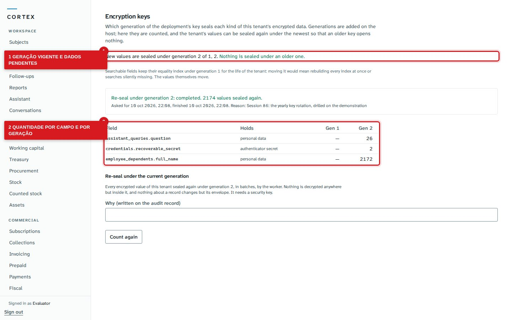

**Administration → Encryption keys** (chaves de criptografia) mostra qual geração da chave mestra
da instalação protege cada tipo de dado pessoal, contada a partir dos cabeçalhos dos valores
cifrados: nada é decifrado para contar. Nesta demonstração a rotação anual já foi ensaiada: a
geração 2 protege tudo, a geração 1 está aposentada — mantida só para abrir o que backups
anteriores guardam — e nada resta sob ela.

A rotação é um ato do operador do servidor: `cortexctl rotate-kek` adiciona uma geração, cada
valor de cada inquilino é selado de novo com ela em lotes, sem parar o serviço e sem alterar o
conteúdo de nenhum registro, e a geração anterior só é aposentada quando nada resta sob ela.
Numa instalação própria, um administrador com uma **chave de segurança** também pode pedir a
re-selagem nesta tela; o avaliador público não tem essa capacidade, porque uma re-selagem é uma
carga que qualquer um poderia iniciar à vontade.

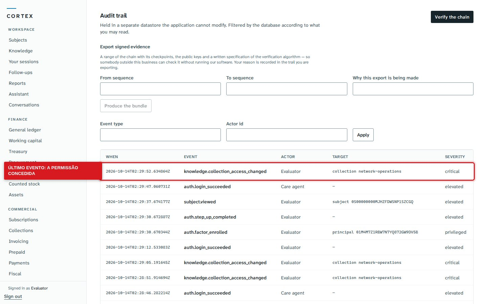

**Administration → Audit trail** (pede o segundo fator): cada alteração, em ordem, encadeada por
hash por inquilino e assinada em pontos de verificação, de modo que um registro removido ou
alterado quebra a cadeia. A permissão do Roteiro 4 aparece no topo como
`knowledge.collection_access_changed`; os eventos `platform.keys_rotated` e
`platform.keys_resealed` do ensaio de rotação estão mais abaixo. Cada resposta da API leva um
identificador de correlação, que está no registro que ela produziu.

---

## Roteiro 6 — Um modelo para o assistente

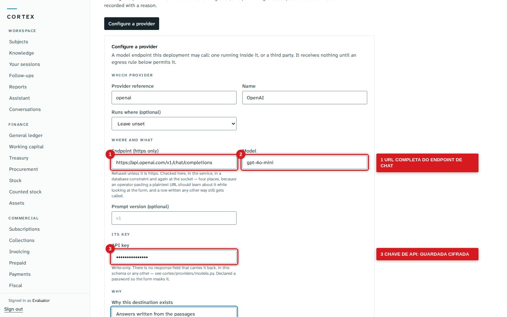

**Administration → AI providers → Configure a provider** (configurar um provedor):

| Campo | Digitar |
| --- | --- |
| Provider reference | `openai` |
| Name | `OpenAI` |
| Runs where | Hosted |
| Endpoint (https only) | A URL completa de chat completions, p. ex. `https://api.openai.com/v1/chat/completions`: qualquer endpoint compatível com OpenAI |
| Model | Um modelo que a sua conta ofereça |
| API key | A sua chave. Ela é cifrada ao chegar e nenhum endpoint a devolve |
| Why this destination exists | `Respostas redigidas a partir dos trechos` |


Um provedor sem regra **não recebe nada**. Dê uma a ele: referência `openai`, **May receive**
(pode receber) *Up to internal* (até interno), e um motivo. Depois, no **Assistant**, escolha-o
em **Answer with** (responder com) e pergunte. O modelo recebe só os trechos que esta conta pode
ler *e* cuja sensibilidade a regra permite: pergunte sobre faturamento eletrônico e os trechos
confidenciais da coleção regulatória ficam **retidos** — contados na resposta, nunca enviados.

> Esta é uma demonstração compartilhada. Uma chave que você adicionar pode ser usada pelo próximo
> avaliador até a restauração noturna. Use uma com limite de gastos e **aposente** o provedor ao
> terminar.

---

## Roteiro 7 — Webhooks para um receptor seu

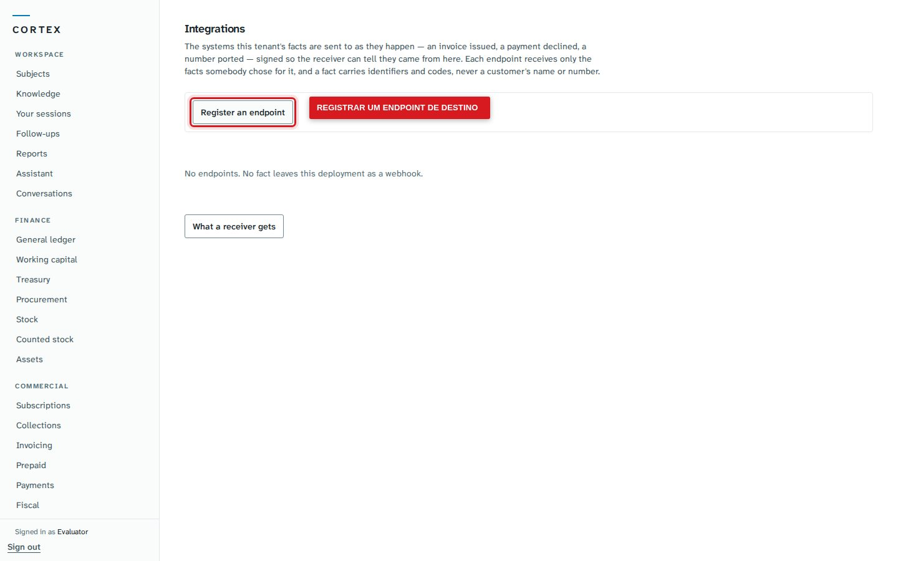

**Administration → Integrations → Register an endpoint** (registrar um endpoint): uma URL `https`
pública que você controle (um endereço privado ou de link local é recusado antes de qualquer
envio), os eventos que ele recebe e um motivo. Guarde o segredo de assinatura, exibido uma única
vez. **Send a test ping** (enviar um teste) entrega um evento assinado; as entregas do endpoint
mostram cada tentativa com o seu status e o seu tempo, e uma entrega que falhou pode ser
reenviada com um motivo. Verifique uma entrega com o SDK deste repositório — três linhas em
Python, TypeScript ou Go — ou rode antes `python examples/smoke.py python`, localmente.

---

## Roteiro 8 — As suas sessões

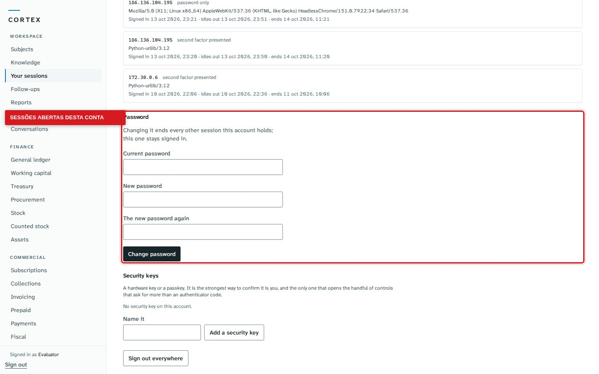

**Workspace → Your sessions** (suas sessões): onde esta conta está conectada. Numa conta de uma
instalação própria, é também aqui que uma pessoa troca a sua senha — provando a atual — e
encerra todas as outras sessões. Nas contas publicadas a troca é recusada, com o motivo: a
entrada delas é administrada pela instalação, para que um avaliador não possa trancar o próximo
do lado de fora.

---

## Pela API

```bash
python examples/evaluate/journey.py
```

Cada roteiro deste guia, pela API que as telas usam, a partir de uma sessão vinculada a uma
chave que o script gera: entrada, elevação, pessoas, a visão do cliente, o corpus, o assistente
fundamentado, o atendente antes e depois de uma permissão, as gerações de chave, a auditoria e o
catálogo de webhooks. A API está documentada em [`api/openapi.json`](../api/openapi.json) e
[`docs/integrating.md`](integrating.md).

## O que é restaurado toda noite

A demonstração inteira — os dois bancos de dados — é restaurada ao mesmo instantâneo toda noite:
o que você criar, conceder, configurar ou quebrar desaparece na manhã seguinte, e o próximo
avaliador encontra os mesmos primeiros cinco minutos que você.
